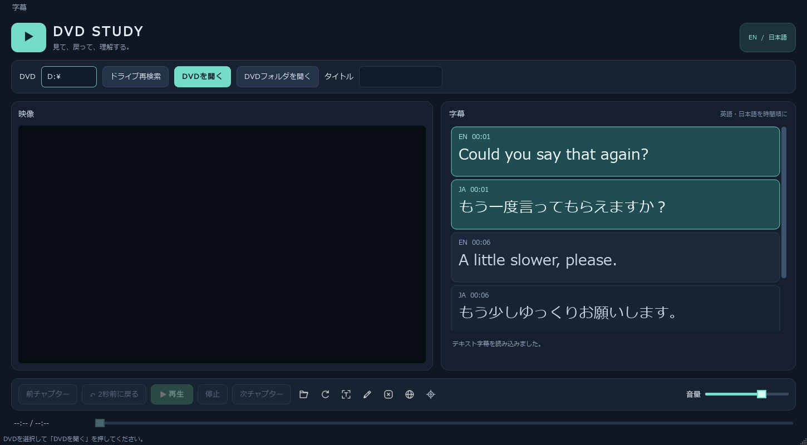
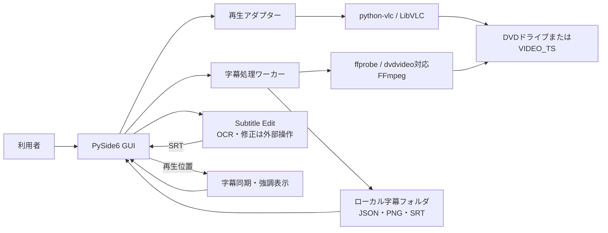

# 英語学習用DVDプレイヤー

こんなことで困っていませんか？

- 日本語と英語の字幕を両方みたい
- 字幕が早く流れてしまうので、前後を少し残したい
- 英語が分からない友人とドラマを楽しみたい

このアプリならこんな悩みを解決します。

更新日: 2026年11月7日。過去の記録では自動テスト55件成功。今回の文書修正ではアプリのテストを再実行していません。

## 1. プロジェクト名

**英語学習用DVDプレイヤー**（English DVD Player）

## 2. 利用者の困りごとと解決方法

| 困りごと | このアプリでできること |
|---|---|
| DVDを見ながら英語と日本語の字幕を比べにくい | 動画の横に英語・日本語の字幕を時系列でまとめて表示し、再生位置に合う行を強調します。 |
| 聞き取れなかった箇所を見直しにくい | 2秒戻し、シーク、チャプター移動を使って再生位置を戻せます。 |
| DVD字幕が画像で、検索・編集しにくい | DVD字幕を画像として抽出し、Subtitle EditでOCR・修正したSRTを読み込んでテキスト表示できます。 |
| DVDを開くたびに字幕を準備し直すのが手間 | 抽出した字幕や読み込んだSRTをDVD・タイトルごとに保存し、次回起動時に再利用します。 |
| 複数のDVDや字幕ファイルを後から見分けにくい | DVD名・ディスク識別子・タイトル・言語で保存先とファイル名を分けます。 |

## 3. アプリケーション概要

Windows上でDVDを再生し、英語学習に使うためのデスクトップアプリです。映像を見ながら英語・日本語字幕を同時に比較できること、字幕画像を保存して外部OCRツールでテキスト化できることを目的とします。

ネットワークサービスや利用者アカウントはありません。DVDの再生・字幕処理・保存はローカルで行います。

## 4. 主な機能

- **DVD再生:** DVDドライブの列挙、DVDおよびVIDEO_TSフォルダの読み込み、タイトル選択。
- **再生操作:** 再生・一時停止、停止、シーク、音量調整、前後チャプター移動、連続操作に対応した2秒戻し。
- **字幕の並列表示:** 英語・日本語の字幕を1つの時系列一覧にまとめて表示し、再生位置に対応する行を強調・追従表示。
- **DVD字幕の抽出:** dvdvideo対応FFmpegで英語・日本語のDVD画像字幕を抽出します。複数トラックや言語不明トラックにも対応します。途中経過も保存し、中止後に利用できます。再取得時は保存済み字幕を引き継ぎ、未完了トラックの最後の保存済み字幕の少し手前から再開します。取得完了したトラックは再取得しません。複数トラックは最も早い再開位置からまとめて読み出します。保存済み字幕がまだないトラックは先頭から取得します。
- **字幕の読み込み:** 検証済みJSON＋画像の字幕manifest、またはSRTを読み込みます。SRTは英語・日本語を指定してテキスト字幕にできます。
- **Subtitle Edit連携:** 画像字幕をBDN XML＋PNGとして書き出してSubtitle Editを起動します。OCRの認識・確認・修正はSubtitle Edit側で行います。OCR結果のSRTはアプリで読み込みます。
- **字幕の再利用:** 読み込んだ字幕、抽出結果、言語不明トラックの割り当てをローカルに保存します。

## 5. 画面・利用イメージ

画面左にDVD映像、右に英語・日本語字幕を時系列でまとめた1つの一覧を配置し、字幕画像や長いテキストに横幅を使います。各行には言語と時刻を表示し、再生位置に対応する字幕を強調します。字幕トラックの切り替えは画面上部の「字幕」メニューから行えます。下部に再生操作、字幕アイコン、音量バーを同じ列に配置し、アイコンの説明はマウスオーバーで表示します。字幕一覧から対象言語を選んでからSRT読み込みやOCR操作を行います。画像字幕は最大約64px高に縮小し、テキスト字幕は最低20ptで表示します。

濃紺とミントを基調に、動画と字幕をカードとして配置しています。以下は表示確認用の例文を使ったGUIプレビューです。



## 6. 技術スタック

| 分類 | 技術 | 用途 |
|---|---|---|
| 言語 | Python 3.11以上（開発・確認環境は3.13） | アプリケーション |
| GUI | PySide6 6.12.0 | ウィンドウ、字幕一覧、操作UI |
| 再生 | python-vlc 3.0.21203、VLC 3.0.24 | DVD再生。VLC本体は別途必要 |
| 字幕抽出 | dvdvideo対応FFmpeg full 9.0.2とffprobe | DVD字幕のトラック情報・画像の抽出 |
| OCR・字幕編集 | Subtitle Edit 5.4.0（任意） | BDN画像字幕のOCR、修正、SRT出力 |
| 保存形式 | JSON、PNG、SRT | 字幕manifest、画像字幕、テキスト字幕 |
| テスト | Python unittest、任意のPyAV | ロジック・GUI・抽出処理のテスト。PyAVは合成テスト用 |
| データベース／外部サービス | なし | DBサーバーやAPIは利用しません |

依存バージョンは[pyproject.toml](pyproject.toml)で管理しています。VLC・FFmpeg・Subtitle EditはPythonパッケージとは別の外部プログラムです。

## 7. システム構成



アプリのGUIがDVDの再生位置を読み取り、英語・日本語それぞれの字幕一覧を同期します。DVD字幕抽出やドライブ情報の読み取りはワーカーから外部プロセスを呼び出し、UIスレッドを長時間ブロックしない構成です。抽出画像と字幕manifestはローカル保存し、次回起動時に読み込みます。

## 8. 構成のポイントと採用理由

- **再生エンジンと字幕処理の分離:** 再生はLibVLC、DVD画像字幕抽出はFFmpegを使います。字幕抽出コードにはDVDナビゲーション情報の確認と抽出の中止処理があります。基本設計・詳細設計でも処理を分離して記述しています。
- **ローカルGUIアプリ:** 実装にはWeb API、クラウドサービス、サーバー、RDBはありません。データはユーザーのPC内に保存します。単一ユーザー向けローカルアプリとして構成されていることはコードから確認できますが、特定のフレームワーク選定理由が明文化されていない箇所は推測していません。
- **字幕形式の検証:** manifest読み込み時にDVD識別子・タイトル・言語・時刻・重複ID・画像パスなどを検証します。未取得の字幕はcoverage範囲を使って、取得済み区間と未取得区間を区別します。
- **障害時の扱い:** VLCが使えない場合は案内を表示します。DVD字幕抽出は中止可能で、失敗時はアプリ内にエラーを表示します。キャッシュ書き込みに失敗しても元データで表示できる場合があります。
- **ローカル処理の制約:** DVDを抽出中はドライブ負荷が上がります。FFmpegのdvdvideoは暗号解除を行わず、媒体やドライブの条件によって字幕を読めない場合があります。

## 9. DB構造

**リレーショナルデータベースは使用していません。** SQLテーブル、主キー、外部キー、DBマイグレーションはありません。永続データはファイルシステム上のディレクトリ、JSON manifest、PNG、SRTです。

```text
subtittle/
└─ <DVD名>/
   └─ <SHA-256 DVD識別子>/
      └─ title-XX/
         ├─ language_map.json
         ├─ subtitles.en.srt                 # 読み込んだ場合
         ├─ subtitles.ja.srt                 # 読み込んだ場合
         ├─ <track_id>/
         │  ├─ manifest.json
         │  └─ images/
         │     └─ 000000.png                 # 画像字幕の場合
         └─ ocr/
            └─ title-XX.en-<一意なID>/        # OCR用の書き出し例
```

manifestの主な情報:

| 項目 | 用途・制約 |
|---|---|
| `schema_version` | 現行形式は`1` |
| `media_id` | DVDのIFO情報を元にした識別子。読み込み時に一致を検証 |
| `title_id` | DVD内タイトル番号。内部値は0始まり |
| `language` | `en`または`ja` |
| `track_id` | トラック識別子。トラックごとのディレクトリ名にも使用 |
| `complete`, `coverage` | 抽出完了状態と取得済み時間範囲 |
| `cues` | 字幕行の配列。各行は一意な`cue_id`、開始・終了ミリ秒、および画像パスまたはテキストを持つ |

字幕行の`cue_id`はmanifest内で重複不可です。track_idは保存単位の識別子です。読み込んだ英語・日本語SRTは各言語の固定名で保存・更新されます。字幕データには複数トラックを保持できます。

字幕保存先は仕様書・基本設計書・詳細設計書と共通です。既定はプロジェクトルートの`subtittle/`、`DVD_PLAYER_DATA_DIR`指定時はその配下です。

## 10. セットアップ方法

### 前提条件

- Windows 10/11
- Python 3.11以上（開発・テスト確認はPython 3.13）
- DVDドライブと再生可能なDVD-Video、または利用可能な`VIDEO_TS`フォルダ
- Pythonと同じビット数のVLC。アプリはLibVLC DLLと`plugins`を使用します。
- DVD字幕を自動抽出する場合はdvdvideo対応のFFmpeg full版と`ffprobe`
- OCRを行う場合はSubtitle Editと使用するOCRエンジン・言語データ。これらの設定はSubtitle Edit側で行います。

### Python依存のインストール

プロジェクトルートでPowerShellを開きます。

```powershell
python -m venv .venv
.\.venv\Scripts\python.exe -m pip install -e .
```

DVD字幕の自動抽出が不要な場合、FFmpegは必須ではありません。Subtitle Editもアプリの基本再生には不要です。

### 外部ツール

必要な場合、プロジェクトルートで導入スクリプトを実行します。ダウンロードしたVLC・FFmpeg・Subtitle Editは`.tools/`に展開され、SHA-256照合を行うスクリプトがあります。

```powershell
.\VLC導入.ps1
.\FFmpeg導入.ps1
.\SubtitleEdit導入.ps1
```

導入するツールの役割:

- VLC: DVD再生に必要
- FFmpeg: DVDから字幕を自動抽出する場合に必要
- Subtitle Edit: 画像字幕をOCR・編集する場合に必要

### 起動

```powershell
.\.venv\Scripts\python.exe -m dvd_player
```

または、仮想環境を作成済みなら:

```powershell
.\起動.ps1
```

## 11. 環境変数

| 変数 | 必須 | 用途 |
|---|---:|---|
| `VLC_HOME` | いいえ | 標準配置でVLCが見つからない場合、`libvlc.dll`と`plugins`があるフォルダを指定します。 |
| `FFMPEG_HOME` | いいえ | PATHや`.tools/`からFFmpegが見つからない場合、`ffmpeg.exe`と`ffprobe.exe`がある`bin`フォルダを指定します。 |
| `SUBTITLE_EDIT_PATH` | いいえ | 自動検出できないSubtitle Edit実行ファイルのフルパスを指定します。 |
| `DVD_PLAYER_DATA_DIR` | いいえ | ローカルデータ配置の基準フォルダを変更します。ログは`<指定先>/logs/`、字幕は`<指定先>/subtittle/`になります。未指定時のログは`%LOCALAPPDATA%/dvd_player/logs/`です。 |
| `WINDIR` | いいえ（Windows標準） | Windowsの日本語フォントがQtで検出できない場合のフォント探索に使います。 |

`ProgramFiles`、`ProgramFiles(x86)`、`LOCALAPPDATA`などのWindows標準環境変数は、VLCやSubtitle Editのインストール先の自動検出に利用します。認証情報や秘密鍵を設定する環境変数はありません。

## 12. 利用可能なコマンド

| 目的 | コマンド |
|---|---|
| 仮想環境作成 | `python -m venv .venv` |
| アプリと依存のインストール | `.\.venv\Scripts\python.exe -m pip install -e .` |
| アプリ起動 | `.\.venv\Scripts\python.exe -m dvd_player` |
| 起動スクリプト | `.\起動.ps1` |
| 全テスト | `.\.venv\Scripts\python.exe -m unittest discover -s 02.src/tests -v` |
| 依存関係の検査 | `.\.venv\Scripts\python.exe -m pip check` |
| 合成DVD字幕を含む追加テスト依存 | `.\.venv\Scripts\python.exe -m pip install -e ".[test]"` |
| VLC導入 | `.\VLC導入.ps1` |
| FFmpeg導入 | `.\FFmpeg導入.ps1` |
| Subtitle Edit導入 | `.\SubtitleEdit導入.ps1` |

開発用にDVDの識別子を表示する例（`D:`は実際のドライブへ置き換えます）:

```powershell
.\.venv\Scripts\python.exe -c "from dvd_player.playback import media_identity; print(media_identity('D:/'))"
```

## 13. ドキュメント・設計書

- [仕様書](01.doc/仕様書.html) — 目的、画面、機能、受け入れ条件の仕様案
- [基本設計書](01.doc/基本設計書.html) — 構成、画面、状態遷移、データ設計
- [詳細設計書](01.doc/詳細設計書.html) — モジュール、型、字幕処理、エラー・テスト設計
- [Subtitle Edit連携手順](01.doc/SubtitleEdit連携.md) — OCR用書き出し、SRT読み込み、制約
- [実機確認結果](01.doc/実機確認結果.md) — DVDで確認できた内容と残る検証項目
- [進捗ログ](03.log/current_status.txt) — 実装・検証履歴
- [残課題](03.log/leftover_tasks.txt) — 未完了の検証・作業

仕様書v0.4・基本設計書v0.2・詳細設計書v0.2は現行実装に合わせて更新しています。設計上の概念名と実装クラス名の対応は設計書を参照してください。受入条件と実機確認済みの範囲は区別しています。

## 14. デプロイ方法

配布用インストーラーや実行ファイルを生成する手順は確認できません。現状サポートしているのは、Windows上でPython環境を作り、VLCなど必要な外部ツールを用意して起動する方法です。`.tools/`の外部バイナリはGit管理外のため、別環境では必要に応じて導入スクリプトを実行してください。

## 15. 制約・注意事項

画面またはDVD操作が10秒以上応答しない場合、停止箇所を`%LOCALAPPDATA%/dvd_player/logs/freeze.log`へ自動記録します。操作の開始・完了は同じ場所の`application.log`に記録します。`DVD_PLAYER_DATA_DIR`を指定している場合は、その配下の`logs/`を確認してください。

- DVD-Videoのドライブまたは`VIDEO_TS`フォルダに対応します。ISOや一般動画ファイルの再生には対応していません。
- 字幕抽出はFFmpegのdvdvideo機能に依存します。FFmpeg自体にDVD暗号解除機能はなく、保護状態やドライブのアクセス条件によっては読み出せません。
- FFmpegがDVDを読み直すため、抽出中はドライブ負荷が増えます。再生に影響する場合は抽出を中止してください。
- 字幕画像のOCRはSubtitle Edit側で実行します。「自動OCR」ボタンは画像字幕を書き出してSubtitle Editを起動する機能であり、OCR実行、認識結果の修正、保存後の自動取り込みまでは行いません。SRTを保存後、アプリで読み込んでください。
- OCR結果の認識精度は保証されません。認識後の確認・修正を推奨します。
- 厳密な字幕同期誤差（±300ms）の測定、物理的なDVD取り出し・再挿入時の実機確認、音量の聴感評価は未完了です。全編の連続再生試験も行っていません。
- `subtittle/`にはDVD由来の字幕画像・テキストが保存されます。Gitには登録されない設定ですが、バックアップや共有時は内容に注意してください。
- 字幕manifestの形式を変更するときは`schema_version`、読み込み検証、キャッシュとの互換性を合わせて更新してください。現状、DBマイグレーション機構はありません。
- Pythonパッケージは`pyproject.toml`に記載されていますが、VLC、FFmpeg、Subtitle Editにはそれぞれ個別のライセンス・配布条件が適用されます。

## 16. ディレクトリ構成

```text
.
├─ 00.secret/       ローカル素材・秘密情報（Git管理外）
├─ 01.doc/          仕様書、基本設計書、詳細設計書、連携・実機確認資料
├─ 02.src/
│  ├─ dvd_player/   GUI、再生、抽出、保存、SRT/BDN連携
│  └─ tests/        unittestによるロジック・GUI・保存・抽出テスト
├─ 03.log/          進捗、残課題、作業ログ
├─ subtittle/       DVD別の字幕manifest、画像、SRT、OCR用書き出し（Git管理外）
├─ .tools/          VLC、FFmpeg、Subtitle Editなどのローカル配置（Git管理外）
├─ .venv/           Python仮想環境（Git管理外）
├─ pyproject.toml   パッケージ情報、Python依存、起動エントリーポイント
├─ 起動.ps1         仮想環境を使ったアプリ起動
├─ VLC導入.ps1      ポータブルVLC導入
├─ FFmpeg導入.ps1   dvdvideo対応FFmpeg導入
└─ SubtitleEdit導入.ps1  Subtitle Edit導入
```

主な実装モジュール:

- `core.py`: 字幕データ、manifest検証、再生位置に対応する字幕検索
- `window.py`: PySide6画面、イベント処理、英日統合字幕一覧、ワーカーと状態の制御
- `theme.py`: 濃紺・ミントの配色、操作アイコン、字幕の描画
- `playback.py`: VLC再生とDVD識別
- `extraction.py` / `probe.py`: FFmpeg抽出、DVD情報・存在確認
- `storage.py`: 字幕保存、キャッシュ、言語割り当て、ログ
- `subtitle_edit.py`: SRT解析、BDN XML出力、Subtitle Edit検出・起動

## 17. ライセンス

本プロジェクトのライセンスは**未定義**です。利用・再配布の前に、プロジェクトの権利者へ確認してください。依存ライブラリ、VLC、FFmpeg、Subtitle Edit、GitSecurityToolには各プロジェクトのライセンスが適用されます。
